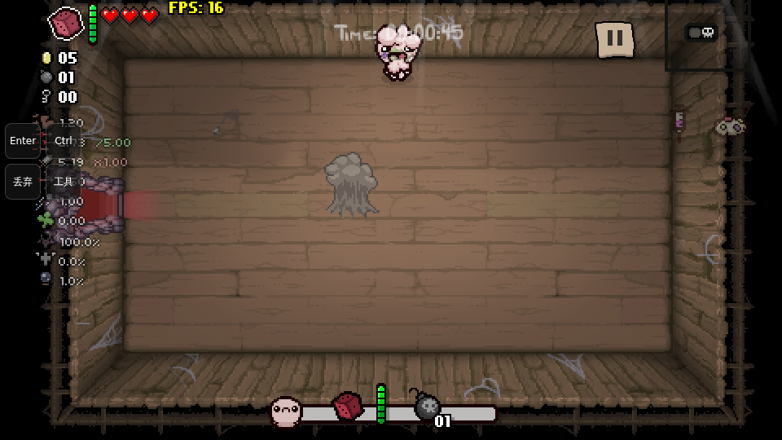

# 以撒网页版与 Android 离线版

基于 [The Browsing of Isaac](https://github.com/chiikabu/the-browsing-of-isaac) 的个人配置版：预置我的 Chrome 存档和 mod，加入手机横屏触控、帧率节奏控制、资源缓存与存档写入保护。

[打开网页版](https://hllqkb.github.io/isaac-web-setup/) · [下载 Android APK](https://github.com/hllqkb/isaac-web-setup/releases/download/v2026.11.05/Isaac-Mobile-2026-11-05.apk) · [版本与源码](https://github.com/hllqkb/isaac-web-setup/releases/tag/v2026.11.05)

更新日期：2026-11-05。初始存档快照：2026-11-04。

## 游戏截图

角色选择与预设完成标记：

电脑浏览器游戏画面：

手机横屏触控布局，左侧保留 Enter、Ctrl、丢弃和可展开的工具按钮。下图来自触控模式的云端实际游戏验证，不是手机实拍；截图 FPS 不代表手机性能。

## 网页与 APK

| | 网页版 | Android 离线版 |
| --- | --- | --- |
| 入口 | [开始游戏](https://hllqkb.github.io/isaac-web-setup/) | [下载 APK，约 624 MB](https://github.com/hllqkb/isaac-web-setup/releases/download/v2026.11.05/Isaac-Mobile-2026-11-05.apk) |
| 运行环境 | 已验证桌面 Chrome；手机自动启用触控布局 | Android 10 及以上，arm64-v8a |
| 游戏资源 | 首次联网加载，后续利用浏览器缓存 | 安装包内置资源与独立 Chromium 内核，可离线玩 |
| 存档 | 保存在当前浏览器、当前网站的本地数据中 | 保存在当前应用数据中 |
| 源码 | 本仓库的网页与共享模块 | [对应版本完整源码 ZIP](https://github.com/hllqkb/isaac-web-setup/releases/download/v2026.11.05/Isaac-Mobile-source-2026-11-05.zip) |

第一次从网页首页进入时，会导入约 25 MB 的初始配置。现有存档不会被正常启动流程自动覆盖；每个人之后各自游玩，进度互不影响。网页和 APK 的存档分别存储，不会自动同步。清除网站数据或卸载应用会删除对应的本地进度。

## 这个版本做了什么

- 预置 3 个存档位、41 个已安装 mod，其中 35 个启用，包含中文 EID 道具说明。完整名单见 [preset-info.json](preset-info.json)。
- 手机使用原生触控区域移动和射击；修正滑动方向、菜单滑动与边缘瞄准，补齐确认、物品切换、丢弃和工具入口。电脑保留键盘操作。
- 游戏更新节奏与屏幕刷新率解耦，避免高刷新率屏幕让游戏变快。实际流畅度仍取决于设备、mod 和房间内容。
- 缓存解码后的音频资源；网页资源等待时显示提示，下载停滞时使用备用地址重试。首次加载、缓存失效和引擎初始化仍需要时间，不能完全跳过 0–100 加载。
- 存档写入等到 IndexedDB 事务提交成功后才确认，失败会重试；工具中的“保存退出”走游戏原生保存流程。
- APK 第一次按系统返回时暂停并提示，再按一次离开。系统仍保留应用进程时，再点图标可返回原画面；进程被系统回收后需要重新加载。

## 操作

| 动作 | 电脑键盘 | 手机 |
| --- | --- | --- |
| 移动 / 射击 | WASD / 方向键 | 左侧移动 / 右侧射击触控区 |
| 确认 / 跳过可跳过的过场 | Enter | 左侧 Enter |
| 主动道具 | Space | 点击游戏内道具区域 |
| 炸弹 | E | 点击游戏内炸弹区域 |
| 卡牌 / 药丸 | Q | 点击游戏内卡牌或药丸区域 |
| 切换物品 / 双角色相关操作 | Ctrl，具体行为由角色决定 | 左侧 Ctrl |
| 丢弃饰品 / 卡牌 / 药丸 | 长按 Ctrl | 点击左侧“丢弃”，自动保持按键约 3 秒 |
| 地图 / 暂停 | Tab / Esc | 游戏内地图 / 暂停按钮 |
| 回到上一间房 / 游戏终端 | 使用游戏终端 | 展开“工具”，选择 rewind 或终端 |

选人界面的 E 操作会按界面状态提供。工具还包含保存退出和性能诊断；死亡结算画面仍可尝试 rewind，但引擎已经崩溃或本局不可回溯时无法恢复。

## 进度与已知限制

存档保护用于减少写入失败导致的数据丢失，**不等于每个房间自动保存**。正常离开前建议使用“工具 → 保存退出”。崩溃后只能恢复到游戏最近实际生成并成功写入的存档点，不能保证回到崩溃前的房间。曾出现的偶发隐藏房崩溃尚未确认根因，不宣称已经消除所有崩溃。

当前网页验证已通过资源超时与备用地址、缓存、帧率节奏、手机按键、首次导入及已有存档保护等 CI 检查。APK 已通过构建、签名、离线资源校验及真实引擎场景检查；最新 APK 尚待更多设备实测。

## 项目内容与来源

- `game.html`：生成后的游戏页面；`upstream/game.html`：上游页面快照。
- `mobile/`：网页与 APK 共用的触控、节奏、缓存和恢复模块。
- `web/`、`scripts/`：网页资源传输及页面补丁。
- `bootstrap.js`、`preset-*.bin`、`preset-info.json`：首次配置导入与快照信息。
- `assets/screenshots/`：本 README 使用的真实游戏截图。
- Releases：已签名 APK 和对应 Android 源码；大文件不放进 Git 历史。

仓库中的旧 `isaac-setup.js` 与备份文件仅保留作历史配置，通常不需要执行；旧导入脚本可能覆盖当前进度。

感谢 [chiikabu 的网页移植项目](https://github.com/chiikabu/the-browsing-of-isaac) 和各 mod 作者。项目代码遵循 [GPL-3.0](LICENSE)，上游及第三方组件保留各自许可。The Binding of Isaac 的游戏内容和商标归 Nicalis, Inc.、Edmund McMillen 及相关权利人所有；本项目与其无官方关联。请支持正版。
