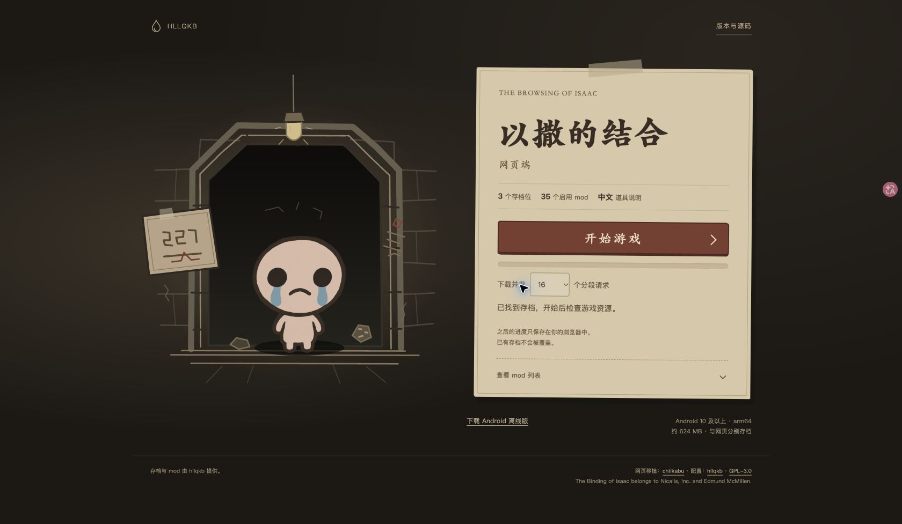

# 以撒网页版与 Android 离线版

在浏览器或 Android 手机上玩以撒。基于 [The Browsing of Isaac](https://github.com/chiikabu/the-browsing-of-isaac)，预置个人存档、常用 mod 和中文道具说明，补充手机触控、完整资源预下载及缓存。

[开始游戏](https://isaac.hllqk.cn/) · [下载 Android APK](https://github.com/hllqkb/isaac-web-mobile/releases/download/v2026.11.05-r2/Isaac-Mobile-2026-11-05-r2.apk) · [版本与 Android 源码](https://github.com/hllqkb/isaac-web-mobile/releases/tag/v2026.11.05-r2)

更新日期：2026-11-06。初始存档快照：2026-11-04。

## 界面与游戏画面

当前首页，来自真实 Chrome 页面截图。点击“开始游戏”后，在这一页完成存档、mod 和游戏资源的准备，再进入游戏。

电脑浏览器中的实际游戏画面。截图里的帧数只是该次运行状态，不代表所有设备的性能。

游戏内的角色选择与预设完成标记：

## 网页与 APK

| | 网页版 | Android 离线版 |
| --- | --- | --- |
| 入口 | [isaac.hllqk.cn](https://isaac.hllqk.cn/) | [下载 APK](https://github.com/hllqkb/isaac-web-mobile/releases/download/v2026.11.05-r2/Isaac-Mobile-2026-11-05-r2.apk) |
| 环境 | 电脑或手机浏览器，推荐 Chrome | Android 10 及以上，arm64-v8a |
| 资源 | 首次预下载，之后复用当前浏览器的缓存 | 安装包内置游戏资源与独立 Chromium 内核，可离线游玩 |
| 操作 | PC 键盘；手机自动显示触控按钮 | 手机横屏触控 |
| 进度 | 当前浏览器、当前网站的本地数据 | 当前应用的本地数据 |

点击开始时会尝试进入全屏，手机再尝试锁定横屏。浏览器拒绝全屏时，可点“进入全屏”重试；不支持方向锁定的浏览器需要手动横置手机。

网页和 APK **分别保存进度，不会自动同步**。每位玩家复制初始存档和 mod 后独立游玩；正常启动不会自动覆盖已有存档。自有域名与旧 github.io 站点的存档也各自独立，不会自动迁移。清除网站数据或卸载应用会删除对应的本地进度。

## 下载与缓存

- 首页统一准备约 25 MB 的存档和 mod 配置，以及约 373 MiB 的完整游戏资源；进度条显示准备进度、网速和预计剩余时间。全部完成并校验后才进入游戏，游戏引擎初始化仍需要时间。
- 下载并发默认 **16**，可选 **4、8、16、32、64、128** 个分段请求。下载中锁定设置，暂停完成后可调整，再继续下载；浏览器会记住选择。更高并发不保证更快。
- 资源按 **1 MiB** 分段下载，中断后复用已经完成的分段；完整文件还会校验 SHA-256。短暂网络中断会自动重试，已校验完成的文件不会因重试而重新下载。
- 直接打开游戏页也保留资源检查和下载兜底。下载时尝试保持屏幕亮起；浏览器或系统仍可能限制后台页面，建议保持页面打开。
- 游戏资源与配置由同一站点提供，正常游玩不依赖 GitHub 或 jsDelivr。APK 下载位于 GitHub Releases。

## 存档、mod 与操作

预置 **3 个存档位、40 个已安装 mod，其中 34 个启用**，包含中文 EID 道具说明。原预置的 drop trinkets faster 会在空存档位开局时让游戏崩溃，已移除：启动时会自动从已安装的 mod 里删掉它（只删 mod，不动存档）。完整名单见 [preset-info.json](preset-info.json)。可在游戏 MODS 菜单调整；之后的进度和设置保存在各自设备中。关掉某个 mod 后，开着它时存下的“未打完的那局”会先收起来（不显示“继续游戏”，数据不删），重新打开这个 mod 后自动恢复；如果在收起期间开了新局，旧的那局会被覆盖。

| 动作 | 电脑键盘 | 手机触控 |
| --- | --- | --- |
| 移动 / 射击 | WASD / 方向键 | 左侧移动 / 右侧射击区域 |
| 确认 / 跳过过场 | Enter | 左侧 Enter |
| 主动道具 | Space | 游戏内道具区域 |
| 炸弹 | E | 游戏内炸弹区域 |
| 卡牌 / 药丸 | Q | 游戏内卡牌或药丸区域 |
| 切换物品 / 双角色相关操作 | Ctrl，依角色而定 | 左侧 Ctrl |
| 丢弃 | 长按 Ctrl | 点“丢弃”，自动保持按键约 3 秒 |
| 地图 / 暂停 | Tab / Esc | 游戏内地图 / 暂停按钮 |
| 回溯 / 终端 | 使用游戏终端 | 展开“工具”，选择回溯或终端 |

选人界面的 E 操作按界面状态提供。左侧额外按钮需在按钮内完成点按，滑出或拖动会取消；工具还包含保存退出和诊断。回溯按一次尝试回到上一间房，无法恢复已经崩溃的引擎。

## 性能与进度保护

完整资源缓存用于减少游玩中临时下载造成的停顿，帧率节奏控制用于避免高刷新率改变游戏速度。实际流畅度仍取决于设备、浏览器、mod 和房间内容；**不保证所有设备都不卡，也不宣称已消除所有崩溃**。

存档写入会等待 IndexedDB 事务完成后才确认，失败时重试。这不等于每个房间自动保存。正常离开前可使用“工具 → 保存退出”；崩溃后只能恢复到游戏最近生成并成功写入的存档点，不能保证恢复到崩溃前的房间。偶发隐藏房崩溃的根因尚未确认。

网页右侧“诊断”可查看帧率、每帧引擎耗时与绘制次数、显卡型号、资源等待、存档写入及最近错误，并导出 JSON 或复制摘要。报告保存在本机，不包含存档和 mod 文件内容，也不会自动上传；主线程完全卡住时可能需要重新打开页面，再导出上次快照。

APK 第一次按系统返回会暂停并提示，再按一次离开。应用进程仍在时可恢复原画面；被系统回收后需要重新启动。

## 源码与来源

本项目仓库：[hllqkb/isaac-web-mobile](https://github.com/hllqkb/isaac-web-mobile)。已签名 APK 与对应 Android 源码放在 [Releases](https://github.com/hllqkb/isaac-web-mobile/releases)，大文件不放进 Git 历史。

- `index.html`、`bootstrap.js`：首页、初始配置导入与游戏入口。
- `web/`：资源预下载、缓存、续传和下载设置。
- `mobile/`：网页与 APK 共用的触控、节奏、缓存和恢复模块。
- `game.html`、`upstream/game.html`、`scripts/`：生成页面、上游快照与页面补丁。
- `preset-*.bin`、`preset-info.json`：初始配置及校验信息。
- `assets/screenshots/`：README 使用的真实页面与游戏截图。

旧 `isaac-setup.js` 与备份文件仅保留作历史配置；旧导入脚本可能覆盖当前进度。

感谢 [chiikabu 的网页移植项目](https://github.com/chiikabu/the-browsing-of-isaac) 和各 mod 作者。项目代码遵循 [GPL-3.0](LICENSE)，上游及第三方组件保留各自许可。The Binding of Isaac 的游戏内容和商标归 Nicalis, Inc.、Edmund McMillen 及相关权利人所有；本项目与其无官方关联。请支持正版。
